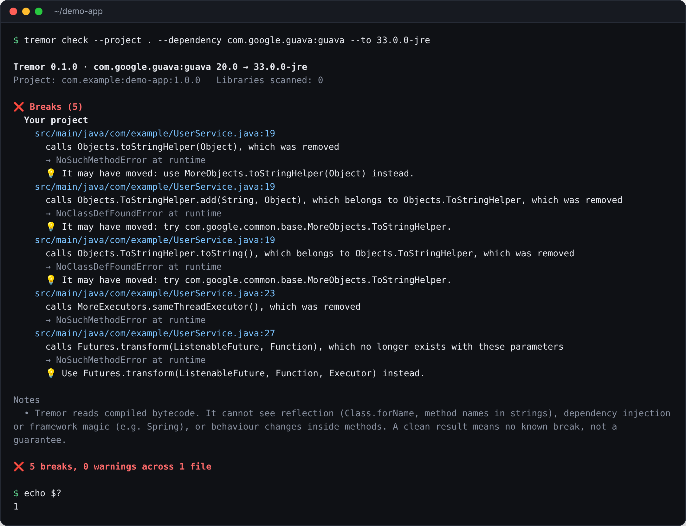
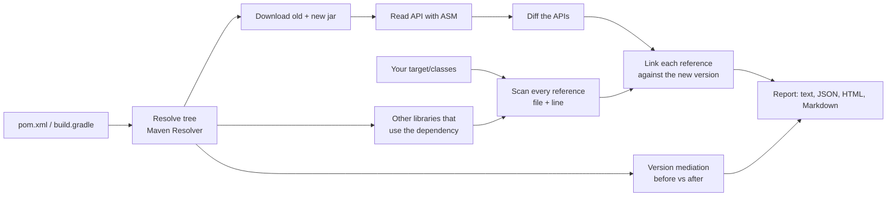

# Tremor

**Feel the shake before you upgrade.**

[](https://github.com/solucent-b/Tremor/actions/workflows/ci.yml)
[](LICENSE)

Tremor answers one question:

> **"If I upgrade this dependency, what will break in *my* project?"**

It downloads the old and new versions of a Java library, compares them **at the bytecode level**,
scans **your compiled code** and **every other library in your dependency tree** for uses of what
changed, and tells you exactly what breaks, where, and what to do about it. No guessing from
changelogs.



## 30-second demo

```bash
git clone https://github.com/solucent-b/Tremor.git && cd Tremor
mvn -q package -DskipTests                     # builds target/tremor-<version>-all.jar
cd examples/demo-app && mvn -q compile         # a tiny app on Guava 20
java -jar ../../target/tremor-*-all.jar check --project . \
     --dependency com.google.guava:guava --to 33.0.0-jre
```

You get the report above. The exit code is `1` because something breaks.

## Install

Tremor needs **Java 21+**. It reads projects built with any Java version.

- **Download** `tremor-0.1.0-all.jar` from the [releases page](https://github.com/solucent-b/Tremor/releases), or
- **Build** it: `mvn package -DskipTests` creates `target/tremor-<version>-all.jar`.

Then add a shell alias:

```bash
alias tremor='java -jar /path/to/tremor-0.1.0-all.jar'
```

## Usage

Tremor reads your **compiled** classes, so compile first (`mvn test-compile`, or
`./gradlew classes testClasses`).

```bash
# One upgrade
tremor check --project . --dependency com.google.guava:guava --to 33.0.0-jre

# Every direct dependency, newest stable version, as a safe / risky / breaks table
tremor check --project . --all-updates

# Reports for humans, machines and pull requests
tremor check ... --format html --output tremor.html
tremor check ... --format json --output tremor.json   # schema: docs/json-format.md
tremor check ... --format markdown

# Behind a company mirror
tremor check ... --repository https://nexus.example.com/repository/maven-public/ --no-central
```

| Option | Meaning |
|---|---|
| `--project DIR` | Project directory with `pom.xml`, `build.gradle` or `build.gradle.kts` (default `.`). |
| `--dependency G:A` | The dependency to upgrade, e.g. `com.google.guava:guava`. It can be a direct or a transitive dependency. |
| `--to VERSION` | The version to upgrade to. |
| `--all-updates` | Check the newest stable version of every direct dependency instead. |
| `--format` | `text` (default), `json`, `html` or `markdown`. |
| `--output FILE` | Write the report to a file instead of the terminal. |
| `--repository URL` | Extra Maven repository, searched before Maven Central (repeatable). |
| `--no-central` | Use only the `--repository` URLs. |
| `--cache-dir DIR` | Cache location (default `~/.tremor/cache`, or `$TREMOR_CACHE`). |
| `--no-color` | Plain text output (also honours `NO_COLOR`). |

**Exit codes**, for CI: `0` safe · `1` breaks found · `2` Tremor itself failed (bad arguments, a
missing version, no compiled classes, ...).

### In GitHub pull requests

Add the action to your repository and every Dependabot or Renovate PR gets **one** comment
(updated on each push), with the full report as a workflow artifact:

```yaml
- uses: actions/checkout@v4
- uses: solucent-b/Tremor@v0.1.0
```

> ✅ **Tremor:** upgrading `guava` 32.1.0-jre → 33.0.0-jre is safe for this project.

See [docs/github-action.md](docs/github-action.md) for the full workflow and its options.

## How to read the report

| Section | Meaning |
|---|---|
| ❌ **Breaks** | Code that **will fail**: at runtime (`NoSuchMethodError`, `NoClassDefFoundError`, `IncompatibleClassChangeError`, ...) and usually also when you recompile. Each break shows the **file and line**, **what it does** ("calls `Cache.getIfPresent(Object)`"), **what changed** ("which was removed"), **what happens** ("→ NoSuchMethodError at runtime") and, when Tremor can tell, **what to use instead** (💡). |
| ⚠️ **Warnings** | Things that still run but deserve a look: newly deprecated APIs, new checked exceptions (your code won't compile without a `try`), a class that stopped implementing an interface, an override the library will no longer call. |
| 🔀 **Version changes** | Maven picks **one** version of each library ("nearest wins"). After the upgrade, some *other* library may get a version it was not built for. `BREAKS` means Tremor found its code using something that's gone; `RISKY` means an older version than it asked for, or a different major version Tremor didn't scan. |
| ✅ **Safe** | Nothing you (or your libraries) use changed. |
| **Notes** | What Tremor couldn't see. Always read these. |

Findings are grouped by **your project** first, then by each **library** in your tree that would
break ("library-y 1.4.2 calls `Strings.isNullOrEmpty(String)`, which was removed"). For your own
code, paths point at your real source files.

## How it works



1. **Read the project.** Tremor parses `pom.xml` (properties, dependency management, parents,
   imported BOMs) or the Gradle build and version catalog.
2. **Resolve the dependency tree** with Maven Resolver, before and after the upgrade. Everything
   is cached in `~/.tremor/cache`; your `~/.m2` is never touched.
3. **Read both versions** of the library with ASM into an API model: classes, methods, fields,
   access flags, superclasses and interfaces. Only `public`/`protected` counts as API.
4. **Diff** the two models: removed classes, methods, fields and constructors, changed
   parameters and return types, lower visibility, `final`/`abstract`, static ↔ instance, removed
   interfaces, new abstract methods, new checked exceptions, deprecations. Inherited members are
   followed, so a method that moved to a superclass is **not** a break.
5. **Scan** your bytecode, and every library in the tree that declares the dependency, for each
   reference: calls, field reads and writes, `new`, `extends`/`implements`, casts, `instanceof`,
   annotations, class literals, `catch` blocks, and method references inside lambdas
   (`invokedynamic`). The `LineNumberTable` and `SourceFile` give file and line.
6. **Link** each reference against the new version the way the JVM would. Anything that wouldn't
   link is a break; the diff explains why and suggests a replacement.
7. **Compare the trees** to find libraries that will get a version they didn't ask for.

Parsed APIs and scans are cached by jar hash: a warm check of a project with 160 dependent
libraries takes under a second.

## Limitations

Tremor never claims "100% safe". It can't see:

- **reflection** (`Class.forName`, method names in strings) and **framework wiring** (Spring, DI,
  annotation-driven libraries);
- **behaviour changes** inside a method whose signature didn't change;
- **compile-time constants** that `javac` copied into your classes;
- **generic type** changes (erased in bytecode).

The full list, including the heuristics, is in
[docs/known-limitations.md](docs/known-limitations.md). Gradle support (static reading, no
Gradle run) is described in [docs/gradle.md](docs/gradle.md).

## Contributing

Bug reports, especially **false positives and misses with a small example**, are the most
useful thing you can send. See [CONTRIBUTING.md](CONTRIBUTING.md) for how to build, test and add
a fixture. Design choices are recorded in [docs/decisions.md](docs/decisions.md).

## License

[MIT](LICENSE)
